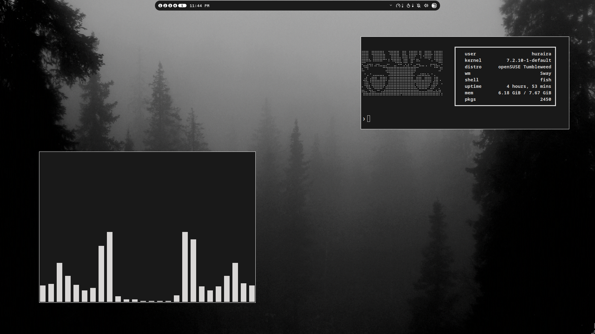

# Dotfiles

Clean, minimalist monochrome desktop setup for Sway on openSUSE.

## Overview

| Component | Software |
| :--- | :--- |
| **Window Manager** | [Sway](https://github.com/swaywm/sway) |
| **Terminal** | [Foot](https://codeberg.org/dnkl/foot) |
| **Shell** | [Fish](https://fishshell.com/) |
| **Editor** | [Neovim](https://neovim.io/) (LazyVim) |
| **Launcher** | [Rofi](https://github.com/davatorium/rofi) |
| **Fetch** | [Fastfetch](https://github.com/fastfetch-cli/fastfetch) |
| **GTK Theme** | Custom Monochrome GTK 3.0 & 4.0 |
| **Colors** | [Noctalia](https://github.com/noctalia-dev/noctalia) |
| **Audio Visualizer** | [Cava](https://github.com/karlstav/cava) |
| **Media Player** | [MPV](https://mpv.io/) + Anime4K Shaders |
| **Power Profile** | GameMode |
